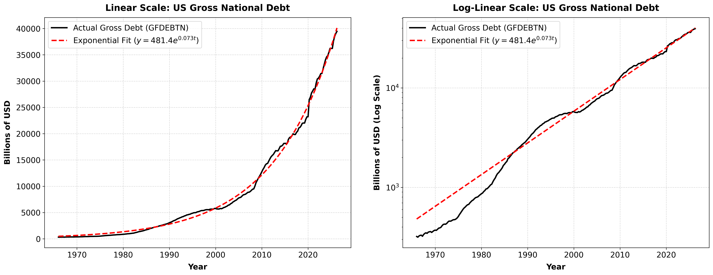
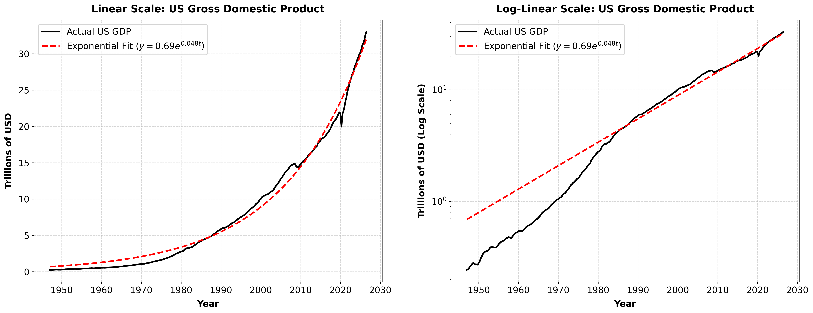
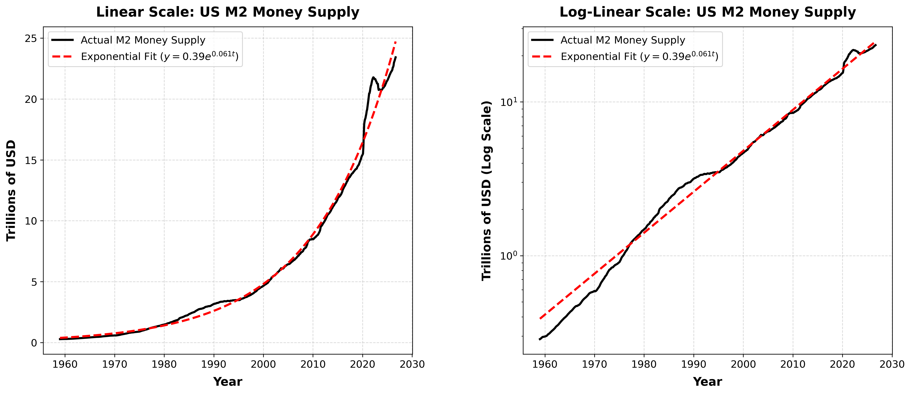
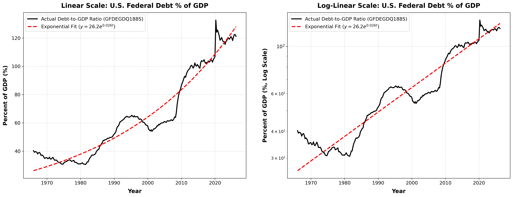
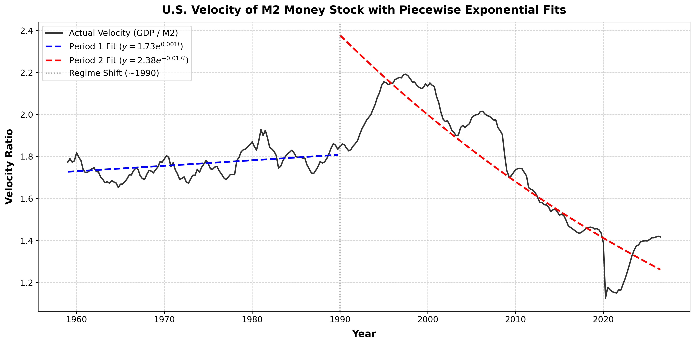

\newcommand{\diff}{\mathrm{d}}
\newcommand{\N}{\mathbb{N}}
\newcommand{\Q}{\mathbb{Q}}
\newcommand{\R}{\mathbb{R}}
\newcommand{\E}{\mathbb{E}}
\renewcommand{\P}{\mathbb{P}}

## Introduction

We illustrate mathematically how several macroeconomic variables, GDP, debt, and money supply (and ratios of these), have been (roughly) exponential over significant time periods. We concentrate on the US due to easy access to publicly available Federal Reserve Economic Data (FRED). It is likely exponential growth in macro variables is a global phenomenon. As has been noted by many, in the long term exponential growth is unsustainable in a bounded world.

These macro variables are linked to each other and population. The exponential growth of population has been enabled by the exponential growth of resource consumption (primarily fossil fuels) due to technological change. Energy extraction and resource consumption are the underlying physical drivers of all these nominal variables. While often overlooked in standard macroeconomic models, economics is fundamentally bounded by physical and thermodynamic realities.

## Model

From a mathematical perspective we can come up with a standard model of compounding growth that produces the exponential. Indeed it is the same model as in my essay on population growth but with a fixed rate. We will first show how one can derive the continuous differential equation from the discrete.

Let $X(t)$ denote a macroeconomic variable at time $t \in [0, \infty)$. Let us start with the discrete time model between time periods of $\Delta t > 0$:

$$
X(t+\Delta t) = (1+k(t)\Delta t)X(t), \quad k(t) \in \R \tag{1} \label{eq_discr}
$$

where $k(t)\Delta t$ represents the fractional growth during the interval. Rearranging \eqref{eq_discr} gives

$$
\frac{X(t+\Delta t)- X(t)}{\Delta t} = k(t)X(t) \tag{2} \label{eq_rear}
$$

Taking the limit of \eqref{eq_rear} as $\Delta t \rightarrow 0$ gives the differential equation for the continuous time model

$$
\frac{\diff X}{\diff t} = k(t)X(t). \tag{3} \label{eq_inst_rate}
$$

For $t \in [t_0, t_1]$, the unique solution is given by

$$
X(t) = X(t_0) \exp\left( \int_{t_0}^{t} k(s) \diff s \right) . \tag{4} \label{eq_sol}
$$

If we assume that the **time-averaged growth rate** over $[t_0, t]$ is approximately constant, say $r > 0$, such that

$$
\frac{1}{t - t_0} \int_{t_0}^{t} k(s) \diff s \approx r , \tag{5} \label{mean_approx}
$$

then \eqref{eq_sol} reduces to

$$
X(t) \approx A e^{rt} , \quad \text{where } A = X(t_0) e^{-rt_0} . \tag{6} \label{eq_exp_lin_model}
$$

## Closure of the Exponential Function

The class of exponential functions is closed under standard arithmetic operations, including division. In particular, we will be looking at the ratio of exponentially increasing macroeconomic variables. Thus, suppose two macroeconomic variables $X_1(t)$ and $X_2(t)$ follow the above model; then for $t \in [t_0,t_1]$:

$$
\begin{align*}
\frac{X_1(t)}{X_2(t)} &= \frac{X_1(t_0)}{X_2(t_0)} \exp\left( \int_{t_0}^{t} (k_1(s) - k_2(s)) \diff s \right) \\
&\approx A \exp((r_1-r_2) t), \quad \text{where } A = \frac{X_1(t_0)}{X_2(t_0)} \exp(-(r_1-r_2) t_0) \tag{7} \label{eq_growth_dif}
\end{align*}
$$

However, we will see this approximation is worse due to the volatility and sign changes of $k_1(t) - k_2(t)$.

## Examples

We now fit an exponential curve to US nominal debt, GDP, and M2, as well as to the debt-to-GDP and velocity of money (GDP to M2) ratios. We use regression as a "good enough" approximation for our needs. With the exception of velocity, we apply a single global fit rather than fitting in segments, even though segmented models better capture changing rates of change.

We present, apart from velocity, the fits to the raw and log-transformed data side by side. The log-transformed data provides a clearer visual assessment of the fit's accuracy, as it linearises the exponential trend into a straight line.

### Gross National Debt

{#fig-debt width=100%}

### Gross Domestic Product (GDP)

{#fig-gdp width=100%}

### M2 Money Supply

{#fig-m2 width=100%}

### Debt-to-GDP Ratio

{#fig-debt_to_gdp width=100%}

### Velocity of Money (GDP / M2)

{#fig-velocity width=100%}

## Analysis of Growth Rates

In this section, we give a brief commentary on the time-averaged growth rates of the US macro variables above. Below is the summary of the growth rates:

| Variable | Approx. Growth Rate ($\hat{r}$) |
|:---|:---:|
| Gross National Debt | $7.3\%$ |
| GDP | $4.8\%$ |
| M2 Money Supply | $6.1\%$ |
| Debt-to-GDP Ratio | $2.6\%$ |
| Velocity (GDP/M2) (Pre-1990) | $0.001\%$ |
| Velocity (GDP/M2) (Post-1990) | $-0.017\%$ |

: Exponential growth rates of US macroeconomic variables. {#tbl-us-macro-growth-rates}

We see that the long-run time-averaged growth rate is greatest for debt, followed by M2 and GDP.

For the ratios, if the variables were exactly exponential, then the growth rate for debt to GDP would be (see equation \eqref{eq_growth_dif}):

$$
7.3\% - 4.8\% = 2.5\%
$$

which is very close to the $2.6\%$ estimated directly from the regression fit. For velocity, fitting GDP and M2 separately across both pre- and post-1990 sub-intervals remains a subject for future work.

## Conclusion

In this essay, we fitted U.S. nominal money supply, debt, GDP from FRED data, and their respective ratios (debt to GDP and income velocity) to exponential curves using standard regression. While this approach largely reinforces established long term empirical regularities among macroeconomic variables, our focus remains strictly descriptive rather than explanatory. Future research could expand upon this work by employing changepoint analysis to identify structural shifts in growth rates over time. Another promising avenue is a deeper investigation into the velocity of money, particularly its relationship with economic inequality, financialisation, and growth. Ultimately, this inquiry opens up a broader, compelling question: is there a fundamental, invariant economic value underlying the macroeconomy?